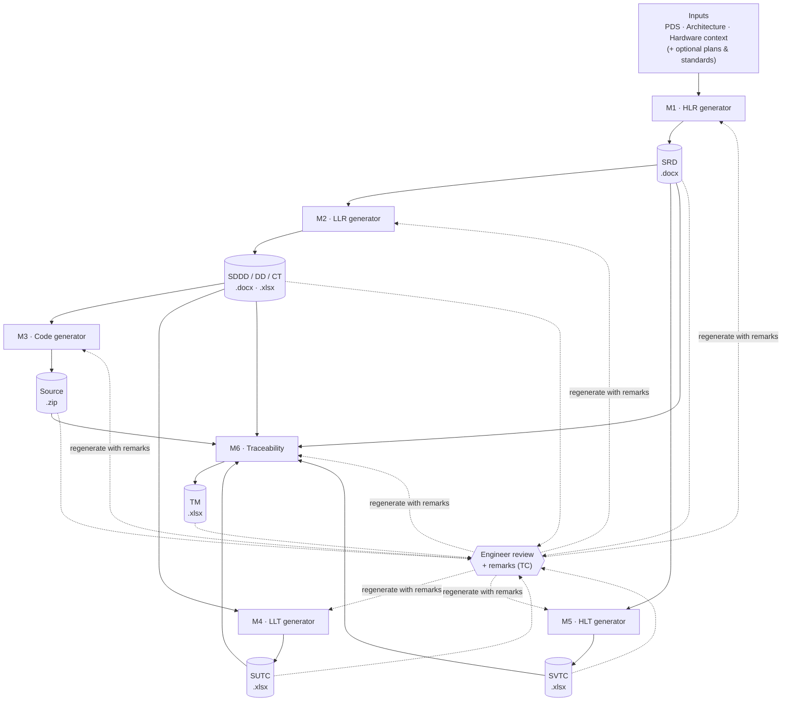

# I-SCEET

**Intelligent Safety-Critical Engineering Environment Toolchain**

A personal open-source project exploring how a chain of local LLMs can draft
DO-178C-style lifecycle artifacts for embedded software — requirements,
design, code, tests and traceability — while keeping a human engineer in the
review loop.

> ⚠️ **Experimental.** Everything I-SCEET generates is a *draft* that must be
> reviewed by a qualified engineer. I-SCEET is not certified tooling and has
> **no DO-330 tool qualification**. Do not use its output as certification
> evidence.

## The problem

In safety-critical projects, a large part of the effort goes into writing and
keeping consistent a long chain of documents: high-level requirements (HLR),
low-level requirements (LLR), source code, low-level tests (LLT), high-level
tests (HLT) and the traceability between all of them. Much of that work is
structured and repetitive, which makes it a reasonable target for LLM
assistance — provided every step stays traceable and reviewable.

I-SCEET splits the work into six specialised generation modules (M1–M6), each
with its own system prompt and model, and wraps them in a UI for uploading
inputs, running the pipeline, reviewing artifacts and sending review remarks
back to the models.

## Pipeline



M4 and M5 derive tests from requirements (LLR/HLR), not from the generated
code, to keep test design independent from the implementation.

## Architecture

```
I-SCEET/
├── ui/                  Streamlit app (upload, pipeline, review, remarks, history)
│   ├── app.py
│   ├── pages/
│   └── theme.py
├── orchestrator/        Pipeline client + document builders
│   ├── pc_pipeline.py   Talks to the model server, versions and stores artifacts
│   ├── srd_builder.py   M1 text  -> SRD .docx
│   ├── sddd_builder.py  M2 text  -> SDDD .docx (+ dd/ct builders -> .xlsx)
│   ├── src_builder.py   M3 text  -> source .zip
│   ├── sutc/svtc/tm_builder.py   M4/M5/M6 text -> .xlsx
│   └── tag_extractor.py, context_summarizer.py
├── models/
│   └── system_prompts/  One system prompt per module (M1..M6)
├── deterministic_core/  Placeholder for non-AI checks (validation, report generation)
├── Backend/db.py        SQLite storage: projects, artifacts, versions, reviews, remarks
├── notebooks/           Colab experiment for M1
├── examples/            Self-made STM32F303 bootloader example inputs
├── config.py            Paths and COLAB_URL from .env
└── start.sh             Creates a venv, initialises the DB, launches the UI
```

**Model server.** The LLMs (default line-up: Qwen3 32B, Mistral Small 24B,
Qwen2.5-Coder 32B, Gemma3 27B, DeepSeek-R1 32B, Phi-4 14B) run on a separate
GPU host — in my setup a Google Colab notebook exposed through ngrok. The
server is not part of this repository; the UI expects it to expose:

| Endpoint | Method | Purpose |
|---|---|---|
| `/status` | GET | health check (`{"status": "online", "gpu_name": ...}`) |
| `/generate_async` | POST | `{"module", "artifacts", "tc_remarks"}` → `{"job_id"}` |
| `/result/<job_id>` | GET | `{"status": "running"\|"done"\|"error", "result": {...}}` |
| `/progress` | GET | `{"module", "stage", "detail"}` for live UI updates |
| `/chat` | POST | `{"module", "question", "artifacts"}` → answer about an artifact |

`models/Model*.py` and `deterministic_core/*.py` are empty placeholders for
now.

## Setup

Requirements: Python 3.10+, and a GPU host running a compatible model server.

```bash
git clone https://github.com/Hatem-Ad/I-SCEET.git
cd I-SCEET
python3 -m venv .venv && source .venv/bin/activate
pip install -r requirements.txt
cp .env.example .env
# edit .env and set COLAB_URL to the public URL of your model server
```

`COLAB_URL` is required; the pipeline page shows an error if it is missing.
Runtime data (`isceet.db`, `data/uploads/`, `outputs/`) is created locally and
is git-ignored.

## Run

```bash
bash start.sh
# or, manually:
cd ui && streamlit run app.py
```

Then open <http://localhost:8501>:

1. **Upload** — create a project and upload the inputs (`.txt`, `.docx` or `.pdf`).
2. **Pipeline** — test the connection to the model server, then run M1→M6
   automatically or module by module.
3. **Revue** — read and approve/reject each generated artifact.
4. **Chat / TC** — ask questions about an artifact and record review remarks;
   modules can be re-run with their open remarks as extra context.
5. **Historique** — browse artifact versions and baselines.

## Example

[`examples/stm32_bootloader/`](examples/stm32_bootloader/) contains a small
PDS, hardware context and architecture description for a UART bootloader on an
STM32F303VC (STM32F3DISCOVERY board), written from scratch for this project.
Upload the three files in step 3 of the Upload page, then run the pipeline.

## Limits

- **AI output must be reviewed.** Requirements, code and tests can be
  incomplete, inconsistent or plain wrong, even when they look well formatted.
- **Not certified tooling.** No DO-330 qualification, no claim of DO-178C
  compliance. The DO-178C vocabulary describes the target document structure
  only.
- Traceability produced by M6 is generated by an LLM; it must be checked
  independently.
- The model server is not included, and generation quality depends heavily on
  the models and hardware used.
- The UI is partly in French.

## License

[MIT](LICENSE) — Copyright (c) 2026 Hatem Adouani
